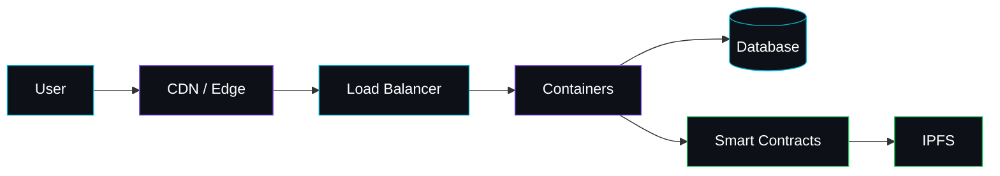

**[angky.my.id](https://angky.my.id)**

## About

Cloud architect and system developer based in Indonesia. I design and run cloud infrastructure, build web applications and backend systems, and spend my spare time learning Web3: smart contracts and decentralized storage.

---

## Tech Stack

**Cloud & Infrastructure**

**Development**

**Web3**

`Solidity` · `Hardhat` · `Ethereum` · `IPFS` · `Web3.js`

---

## Typical Architecture

---

## GitHub Stats

Includes private repositories. Updated daily by GitHub Actions.

**Contributions**

