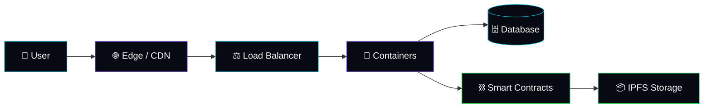

<!-- Ganti `angkykurniawan` dengan username GitHub Anda. Sesuaikan stack & proyek. -->

<div align="center">


[](https://angky.my.id)

<a href="https://angky.my.id"></a>


</div>

<div align="center">

```
 █████╗ ███╗   ██╗ ██████╗ ██╗  ██╗██╗   ██╗
██╔══██╗████╗  ██║██╔════╝ ██║ ██╔╝╚██╗ ██╔╝
███████║██╔██╗ ██║██║  ███╗█████╔╝  ╚████╔╝
██╔══██║██║╚██╗██║██║   ██║██╔═██╗   ╚██╔╝
██║  ██║██║ ╚████║╚██████╔╝██║  ██╗   ██║
╚═╝  ╚═╝╚═╝  ╚═══╝ ╚═════╝ ╚═╝  ╚═╝   ╚═╝
```

</div>

## ⛓️ `genesis.block`

```solidity
// SPDX-License-Identifier: MIT
pragma solidity ^0.8.24;

contract AngkyKurniawan {
    string public role     = "Cloud Architect & System Developer";
    string public focus    = "Cloud Infrastructure | Web Development | Web3";
    string public location = "Indonesia 🇮🇩";
    string public mission  = "Build systems that are fast, secure, and always on.";

    bool public openToCollab = true;

    function currentlyLearning() public pure returns (string[3] memory) {
        return ["Smart Contracts", "Decentralized Storage", "Zero-Knowledge Proofs"];
    }
}
```


## 📡 `node.status`

<div align="center">

| 🧑‍💻 Operator | 🏗️ Role | 🌍 Network | 🟢 Status |
|:---:|:---:|:---:|:---:|
| **Angky Kurniawan** | Cloud Architect | Indonesia 🇮🇩 | **Online** |

</div>

```bash
$ whoami
angky_kurniawan

$ cat /etc/profile
├── 🏗️  Designing cloud architecture that scales
├── 🚀  Building web apps & backend systems
├── 🔐  Hardening infrastructure & automating deployments
├── ⛓️  Bridging traditional cloud with Web3
└── 🌐  Official portal → https://angky.my.id
```


## 🛠️ `tech.stack`

<div align="center">

**☁️ Cloud & Infrastructure**


**💻 Development**


**⛓️ Web3 & Blockchain**


</div>


## 🧱 `architecture.map`




## 📊 `network.stats`

<div align="center">

<!-- Semua SVG di bawah dibuat otomatis oleh GitHub Action (metrics.yml), termasuk data repository PRIVATE -->

### 📦 Repositories · ⭐ Stars · 🔀 Forks


### 🧬 Languages (public + private)


### 🟩 Contributions


### 🐍 Contribution Snake
<picture>
  <source media="(prefers-color-scheme: dark)" srcset="https://raw.githubusercontent.com/angkykurniawan/angkykurniawan/output/github-snake-dark.svg" />
  
</picture>

### 🏆 Trophies


</div>


## 🚀 `featured.deployments`

| 🔹 Project | 📝 Description | 🧰 Stack |
|:--|:--|:--|
| **[angky.my.id](https://angky.my.id)** | Portal resmi & portofolio Cloud Architect | `Web` `Cloud` |
| **Project Name** | Deskripsikan proyek unggulan Anda di sini | `Docker` `Node.js` |
| **Project Name** | Deskripsikan proyek unggulan Anda di sini | `Terraform` `AWS` |
| **Project Name** | Eksperimen Web3 / smart contract Anda | `Solidity` `Hardhat` |

<div align="center">

```
> "Don't trust. Verify."  ⛓️
> Uptime is the only consensus I need.
```


</div>
