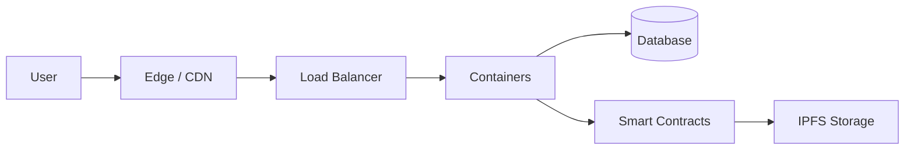

angky@web3:\~/profile/README.md

# ANGKY KURNIAWAN

⛓️ Cloud Architect • System Developer • Web3 Explorer ⛓️

gm 👋 I'm Angky

**PORTAL**angky.my.id**STATUS**NODE ONLINE**CHAIN**WEB3 READY

⛓️

### ANGKY #0001

Cloud Architect · Genesis Edition

Role: **Architect**Chain: **Ethereum**Net: **Indonesia 🇮🇩**Rarity: **Legendary**

```
 █████╗ ███╗   ██╗ ██████╗ ██╗  ██╗██╗   ██╗
██╔══██╗████╗  ██║██╔════╝ ██║ ██╔╝╚██╗ ██╔╝
███████║██╔██╗ ██║██║  ███╗█████╔╝  ╚████╔╝
██╔══██║██║╚██╗██║██║   ██║██╔═██╗   ╚██╔╝
██║  ██║██║ ╚████║╚██████╔╝██║  ██╗   ██║
╚═╝  ╚═╝╚═╝  ╚═══╝ ╚═════╝ ╚═╝  ╚═╝   ╚═╝
```

## ⛓️ genesis.block

```
// SPDX-License-Identifier: MIT
pragma solidity ^0.8.24;

contract AngkyKurniawan {
    string public role     = "Cloud Architect & System Developer";
    string public focus    = "Cloud Infrastructure | Web Development | Web3";
    string public location = "Indonesia 🇮🇩";
    bool public openToCollab = true;

    function currentlyLearning() public pure returns (string[3] memory) {
        return ["Smart Contracts", "Decentralized Storage", "Zero-Knowledge Proofs"];
    }
}
```

## 📡 node.status

| 🧑‍💻 Operator | 🏗️ Role | 🌍 Network | 🟢 Status |
| --- | --- | --- | --- |
| **Angky Kurniawan** | Cloud Architect | Indonesia 🇮🇩 | **● Online** |

```
$ whoami
angky_kurniawan

$ cat /etc/profile
├── 🏗️  Designing cloud architecture that scales
├── 🚀  Building web apps & backend systems
├── 🔐  Hardening infrastructure & automating deployments
├── ⛓️  Bridging traditional cloud with Web3
└── 🌐  Official portal → https://angky.my.id
```

## 🛠️ tech.stack

☁️ Cloud & Infrastructure

AWSGCPDkK8sTFNgx🐧CF

💻 Development

JSTSNodePHPPySQLPG

⛓️ Web3 & Blockchain

EthereumSolidityIPFSHardhatWeb3.js

## 🧱 architecture.map



## 📊 network.stats

#### 📦 Repositories

Public*24*

Private*13*

⭐ Stars*57*

🔀 Forks*12*

#### 🧬 Languages (public + private)

JavaScript*38%*

PHP*24%*

TypeScript*18%*

Shell*12%*

Python*8%*

#### 🔥 Streak

Current*21 days*

Longest*64 days*

Contributions*1,248*

## 🐍 contribution.snake

## 🏆 trophies

**⭐***SSS*Stars

**⌨️***SS*Commits

**🔀***S*Pull Requests

**📦***SS*Repositories

**🔥***A*Streak

**👥***B*Followers

Angka, trophy, dan animasi ular hanya contoh. Data asli (termasuk repo private) dibuat otomatis oleh GitHub Action.

## 🚀 featured.deployments

| 🔹 Project | 📝 Description | 🧰 Stack |
| --- | --- | --- |
| [angky.my.id](https://angky.my.id) | Portal resmi & portofolio Cloud Architect | `Web` `Cloud` |
| Project Name | Deskripsikan proyek unggulan Anda | `Docker` `Node.js` |
| Project Name | Eksperimen Web3 / smart contract | `Solidity` `Hardhat` |

```
> "Don't trust. Verify."  ⛓️
> Uptime is the only consensus I need.
```
